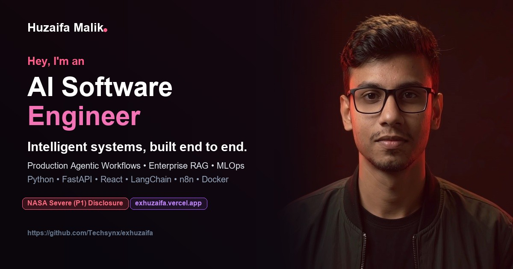

# Huzaifa Malik — AI Software Engineer Portfolio



Live Site: **[https://exhuzaifa.vercel.app](https://exhuzaifa.vercel.app)**  
GitHub: **[https://github.com/Techsynx](https://github.com/Techsynx)**  
LinkedIn: **[https://www.linkedin.com/in/exhuzaifa](https://www.linkedin.com/in/exhuzaifa)**  
Email: [exhuzaifa@gmail.com](mailto:exhuzaifa@gmail.com)

---

## ⚡ Overview

A high-performance **3D interactive developer portfolio** featuring scroll-scrubbed WebGL canvas rendering, smooth inertia scrolling with Lenis & GSAP, and modular React Islands. Tailored for **Huzaifa Malik (exhuzaifa)** — AI Software Engineer specializing in production agentic workflows, enterprise RAG pipelines, and full-stack AI applications.

### 🏆 Key Achievements
* **NASA Vulnerability Disclosure Program (Bugcrowd):** Formally recognized by the NASA Senior Agency Information Security Officer (SAISO) and Office of the CIO for discovering and responsibly disclosing a **Severe (P1)** security vulnerability.
* **3+ Years Production AI Experience:** Designing multi-agent workflows (LangChain, LangGraph, n8n), high-accuracy RAG retrieval over vector stores (Pinecone), and production MLOps pipelines (FastAPI, Docker, SHAP, Evidently AI).

---

## 🛠️ Tech Stack

| Area | Technology | Purpose |
| :--- | :--- | :--- |
| **Framework** | **React 18** | Component architecture & state management |
| **Bundler** | **Vite 6** | Optimized ES modules, code splitting & fast HMR |
| **3D Graphics** | **Three.js & React Three Fiber (R3F)** | 3D interactive service cards & camera paths |
| **Effects** | **Postprocessing & @react-three/drei** | Bloom glow and WebGL camera lenses |
| **Smooth Scroll** | **Lenis** | Physics-driven momentum scrolling |
| **Animations** | **GSAP & ScrollTrigger** | Scroll-tied timelines and element reveals |
| **Styling** | **Vanilla CSS & CSS Variables** | Ultra-clean scoped styling with zero CSS framework bloat |
| **Email API** | **FormSubmit & Web3Forms** | Multi-channel instant delivery to `exhuzaifa@gmail.com` |

---

## 🚀 Getting Started

```bash
# Clone the repository
git clone https://github.com/Techsynx/exhuzaifa.git
cd exhuzaifa

# Install dependencies
npm install

# Start development server
npm run dev

# Build for production
npm run build
```

---

## 📄 License
MIT License © 2026 Huzaifa Malik (Techsynx).
