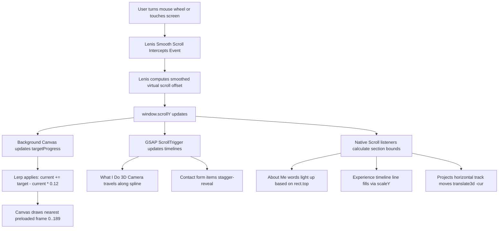

# Project Learning Notes & Architecture Guide (`TECH_NOTES.md`)

This guide explains how your 3D portfolio works from top to bottom. It is written in simple English with short sentences and clear explanations so you can study and reference it anytime.

---

## 1. Tech Stack Overview

| Area | Technology | Version | Purpose in this Project |
| :--- | :--- | :--- | :--- |
| **Framework** | **React** | `18.3.1` | Renders UI components and manages state. |
| **DOM Renderer** | **React DOM** | `18.3.1` | Mounts React components into HTML elements. |
| **Build Tool** | **Vite** | `6.2.0` | Starts the local dev server and bundles the code for production. |
| **Language** | **JavaScript (ES Modules)** | ES2022 | Code uses modern JS features like arrow functions and imports. |
| **3D Engine** | **Three.js** | `0.160.0` | Renders 3D graphics, cameras, and particle dust. |
| **React 3D Bridge** | **@react-three/fiber (R3F)** | `8.18.0` | Lets us write Three.js objects as React components. |
| **3D Helpers** | **@react-three/drei** | `9.122.0` | Provides helpers like `<Html>` to put HTML cards in 3D space. |
| **Postprocessing** | **postprocessing** & **@react-three/postprocessing** | `6.35.3` / `2.16.2` | Adds visual camera effects like bloom (glow). |
| **Smooth Scroll** | **Lenis** | `1.3.27` | Intercepts wheel events for butter-smooth momentum scrolling. |
| **Scroll Animation** | **GSAP** & **ScrollTrigger** | `3.15.0` | Controls timelines pinned to scroll position. |
| **Styling** | **Vanilla CSS + CSS Variables** | Native | Component-scoped CSS files with no heavy framework overhead. |

### Typography (Google Fonts)
- **Plus Jakarta Sans**: Modern sans-serif used for body text, navbar, and About section.
- **Inter**: Clean sans-serif used for tech tags, metadata, and forms.
- **Instrument Serif**: Editorial italic serif font used for highlighted keywords (e.g., *"reality."*, *"remarkable"*).
- **Bebas Neue**: Tall, bold display font used for numbers, project titles, and experience headers.

---

## 2. Dependencies Analysis

Here is every package listed in `package.json`, what it does, and where it is used:

| Package | Version | What It Does (Simple Explanation) | Status in This Project |
| :--- | :--- | :--- | :--- |
| **`react`** | `^18.3.1` | Core library for building components with state. | **Active**: Used across all components in `src/components/`. |
| **`react-dom`** | `^18.3.1` | Connects React components to the real webpage DOM. | **Active**: Used in `src/index.jsx` to mount each section. |
| **`vite`** | `^6.2.0` | Ultra-fast development server and production bundler. | **Active**: Configured in `vite.config.js`. |
| **`@vitejs/plugin-react`** | `^4.7.0` | Adds Fast Refresh and JSX support to Vite. | **Active**: Used in `vite.config.js`. |
| **`three`** | `^0.160.0` | The standard 3D WebGL library for the web. | **Active**: Used in `src/components/WhatIDo/Scene.jsx`. |
| **`@react-three/fiber`** | `^8.18.0` | Declarative Three.js wrapper inside React. | **Active**: Powers `<Canvas>` in `src/components/WhatIDo/Scene.jsx`. |
| **`@react-three/drei`** | `^9.122.0` | Useful helpers for React Three Fiber. | **Active**: Uses `<Html>` to pin DOM cards inside the 3D scene. |
| **`@react-three/postprocessing`** | `^2.16.2` | Wrapper to add camera lens effects in R3F. | **Active**: Adds subtle `<Bloom>` glow in `WhatIDo/Scene.jsx`. |
| **`postprocessing`** | `^6.35.3` | High-performance postprocessing library for Three.js. | **Active**: Underlying engine for bloom and glow passes. |
| **`gsap`** | `^3.15.0` | Industry-standard animation and timeline library. | **Active**: Powers scroll pins in `WhatIDo.jsx`, reveals in `ContactSection.jsx`, and Lenis sync in `main.js`. |
| **`lenis`** | `^1.3.27` | Smooth scrolling library. | **Active**: Initialized in `main.js`, synced with background and footer. |
| **`sharp`** | `^0.35.5` | Fast image processing library for Node.js. | **Dev Only**: Used for offline image resizing scripts; not bundled into client code. |
| **`canvas-confetti`** | `^1.9.4` | Triggers party confetti explosions in canvas. | **Unused**: Safe to remove or keep for future form success celebration. |
| **`framer-motion`** | `^14.9.0` | React animation library. | **Unused**: All current animations use GSAP, CSS, or rAF. |
| **`lucide-react`** | `^1.66.0` | Icon package for React. | **Unused**: Icons in this project are custom, lightweight inline SVGs. |
| **`clsx`** | `^2.1.1` | Utility to combine class names conditionally. | **Unused**: Classes are toggled with standard template literals. |
| **`tailwind-merge`** | `^3.7.0` | Resolves Tailwind CSS class conflicts. | **Unused**: The project uses pure Vanilla CSS. |

---

## 3. Project Structure

```
d:/3d-portfolio/
├── index.html                   # Main page layout, navbar, static hero, and mount roots
├── main.js                      # Lenis smooth scroll setup and GSAP integration
├── style.css                    # Global design tokens, navbar, hero, and base utilities
├── vite.config.js               # Vite bundler configuration
├── package.json                 # Project dependencies and npm scripts
│
├── public/
│   └── frames/                  # 190 high-resolution JPG sequence frames (ezgif-frame-001.jpg .. 190)
│
└── src/
    ├── index.jsx                # The entry bridge: mounts React components into HTML IDs
    │
    ├── components/
    │   ├── background/
    │   │   ├── FrameBackground.jsx   # 2D Canvas sequence player driven by scroll
    │   │   └── FrameBackground.css   # Fullscreen fixed positioning and top/bottom blends
    │   │
    │   ├── about/
    │   │   ├── AboutMe.jsx           # Word-by-word scroll highlighting and card reveal
    │   │   └── AboutMe.css           # 3-column face-clear grid and text shadow glow
    │   │
    │   ├── WhatIDo/
    │   │   ├── WhatIDo.jsx           # Section pin container, GSAP timeline, fallback switcher
    │   │   ├── Scene.jsx             # Three.js 3D world: camera curve, flowing dots, dust
    │   │   ├── whatIDo.css           # Cards layout, vignette overlays, typography
    │   │   └── data.js               # Service cards content and 3D coordinate points
    │   │
    │   ├── skills/
    │   │   ├── SkillsSection.jsx     # Two-row infinite marquee ribbons
    │   │   └── SkillsSection.css     # CSS keyframe animation, paused on hover, mask gradient
    │   │
    │   ├── projects/
    │   │   ├── OriginalsScroll.jsx   # Pinned horizontal carousel with velocity skew and HUD
    │   │   └── OriginalsScroll.css   # Horizontal track, skew transitions, card gradients
    │   │
    │   ├── experience/
    │   │   ├── ExperienceTimeline.jsx# Sticky split timeline with rolling digit counter
    │   │   └── ExperienceTimeline.css# Dynamic line draw, dot glow, clip-path card reveal
    │   │
    │   ├── contact/
    │   │   ├── ContactSection.jsx    # Netlify contact form with magnetic button
    │   │   └── ContactScene.jsx      # (Optional) floating visual elements
    │   │
    │   └── footer/
    │       ├── FooterSection.jsx     # Site footer, social links, back-to-top scroll
    │       └── FooterSection.css     # Dark card styles, pulse dot, responsive layout
    │
    ├── data/
    │   └── contact.js           # Contact form topics and social profile links
    │
    └── styles/
        └── contact.css          # Contact section form layout and styling
```

### Architectural Pattern: "React Islands"
Instead of rendering the entire site as a Single Page App (SPA), `index.html` renders the base layout (Navbar, Hero, Brands). React is mounted into targeted container divs (`#bg-root`, `#about-root`, `#services-root`, etc.) via `src/index.jsx`. This keeps page load fast and isolates complex 3D or animation logic.

---

## 4. Animations and Effects: Detailed Breakdown

### 1. Scroll-Driven Frame Sequence Background
- **Location**: Hero through "What I Do" section (`src/components/background/FrameBackground.jsx`).
- **What You See**: A crisp photo background of the creator that smoothly turns his head as you scroll down, then stops when "What I Do" finishes.
- **Techniques Used**:
  - `HTMLCanvasElement.getContext('2d')`: Hardware-accelerated canvas drawing.
  - `requestAnimationFrame`: Runs drawing on every screen refresh.
  - Linear Interpolation (Lerp): Makes frame transitions silky smooth.
  - Image Preloading + Nearest Neighbor Fallback: Eliminates flashing if a frame is still loading.
- **Code Snippet**:
```javascript
// FrameBackground.jsx
const tick = () => {
  currentProgress += (targetProgress - currentProgress) * 0.12; // Lerp smoothing
  const frameIndex = Math.round(currentProgress * (TOTAL_FRAMES - 1));
  drawFrame(frameIndex);
  requestAnimationFrame(tick);
};
```

---

### 2. About Me: Word-by-Word Scroll Lighting
- **Location**: About section (`src/components/about/AboutMe.jsx`).
- **What You See**: As you scroll through the section, words in the lead paragraph light up one by one. Highlighted skills turn vibrant pink (`#ff5c8a`).
- **Techniques Used**:
  - `element.getBoundingClientRect()`: Calculates how far down the screen the text is.
  - `window.addEventListener('scroll')`: Updates lighting ratio.
  - CSS class toggle (`is-lit`): Changes word opacity from `0.44` (`#ffffff70`) to `1.0` (`#f6f3f7`).
- **Code Snippet**:
```javascript
// AboutMe.jsx
const lr = lead.current.getBoundingClientRect();
const p = clamp((vh * 0.9 - lr.top) / (vh * 0.3), 0, 1);
const lit = Math.round(p * words.length);
words.forEach((w, i) => w.classList.toggle("is-lit", i < lit));
```

---

### 3. About Me: Spinning Star Icon
- **Location**: About Me header (`src/components/about/AboutMe.css`).
- **What You See**: An eight-point star icon continuously rotates next to the "ABOUT ME" title.
- **Techniques Used**: CSS `@keyframes` with `transform: rotate(360deg)` and `animation: ab-spin 14s linear infinite`.
- **Code Snippet**:
```css
/* AboutMe.css */
@keyframes ab-spin {
  to { transform: rotate(360deg); }
}
.ab-spark {
  animation: ab-spin 14s linear infinite;
}
```

---

### 4. What I Do: Pinned 3D Tunnel & Card Flight
- **Location**: Services section (`src/components/WhatIDo/WhatIDo.jsx` & `Scene.jsx`).
- **What You See**: The screen pins in place for 500% scroll distance. The headline slides up, and the 3D camera travels down a spline curve while cards float into view with glowing dots.
- **Techniques Used**:
  - `gsap.timeline` + `ScrollTrigger`: Pins the section and scrubs timeline based on scroll.
  - `THREE.CatmullRomCurve3`: Defines the smooth 3D flight path.
  - `@react-three/fiber` `useFrame`: Updates camera position every frame based on scroll progress.
- **Code Snippet**:
```javascript
// WhatIDo.jsx
const tl = gsap.timeline({
  scrollTrigger: {
    trigger: root.current,
    start: () => `top ${navH()}px`,
    end: '+=500%',
    scrub: 1,
    pin: true,
    onUpdate: (self) => { progress.current = self.progress; }
  }
});
```

---

### 5. Skills: Continuous Dual-Direction Marquee
- **Location**: Skills section (`src/components/skills/SkillsSection.jsx` & `SkillsSection.css`).
- **What You See**: Two rows of skill badges continuously stream horizontally (row 1 moves left, row 2 moves right). Hovering pauses the animation.
- **Techniques Used**:
  - CSS `@keyframes` shifting `translateX(-100%)`.
  - Duplicated track content to create an infinite, seamless loop.
  - `animation-play-state: paused` on `:hover`.
  - `-webkit-mask-image`: Fades the left and right edges softly into the dark background.
- **Code Snippet**:
```css
/* SkillsSection.css */
.sk-marquee-left .sk-marquee-track {
  animation: sk-scroll-left 30s linear infinite;
}
.sk-marquee-wrap:hover .sk-marquee-track {
  animation-play-state: paused;
}
@keyframes sk-scroll-left {
  0% { transform: translateX(0); }
  100% { transform: translateX(-100%); }
}
```

---

### 6. Projects: Pinned Horizontal Scroll with Velocity Skew
- **Location**: Projects section (`src/components/projects/OriginalsScroll.jsx`).
- **What You See**: Vertical scrolling moves large project cards horizontally across the screen. Faster scrolling skews cards slightly and adds motion blur. A bottom HUD shows the exact percentage.
- **Techniques Used**:
  - `position: sticky`: Locks the viewport while dynamic height on parent allows scrolling.
  - Velocity detection: `const vel = target - cur`.
  - Dynamic transform: `skewX(${skew}deg)` and `scale()`.
  - `ResizeObserver`: Re-measures track width on window resize.
- **Code Snippet**:
```javascript
// OriginalsScroll.jsx
const vel = target - cur;
cur += vel * 0.1; // Lerp smoothing
track.current.style.transform = `translate3d(${-cur}px,0,0)`;
const skew = clamp(-vel * 0.04, -8, 8);
cards.forEach(c => c.style.transform = `skewX(${skew}deg)`);
```

---

### 7. Experience: Rolling Slot Number & Vertical Progress Line
- **Location**: Experience section (`src/components/experience/ExperienceTimeline.jsx`).
- **What You See**: As you scroll through jobs and education, a red vertical line draws downward, dots illuminate, and a giant number in the sticky left sidebar rolls like a slot machine.
- **Techniques Used**:
  - `position: sticky`: Keeps the left title and count in place.
  - CSS transform translateY with custom cubic-bezier: `calc(var(--i) * -1.05em)`.
  - `scaleY` progress fill: `fill.current.style.transform = scaleY(...)`.
  - Radial gradient mouse spotlight on card hover: `radial-gradient(circle at var(--mx) var(--my), ...)`.
  - `clip-path` reveal: Cards un-clip from top to bottom on scroll.
- **Code Snippet**:
```javascript
// ExperienceTimeline.jsx
fill.current.style.transform = `scaleY(${clamp((vh * 0.5 - lr.top) / lr.height, 0, 1)})`;
side.current.style.setProperty("--i", bestIndex); // Rolls slot number
```

---

### 8. Contact: Magnetic Submit Button
- **Location**: Contact section (`src/components/contact/ContactSection.jsx`).
- **What You See**: When your mouse hovers near the "Send message" button, the button magnetically pulls toward your cursor. When you move away, it snaps back with an elastic bounce.
- **Techniques Used**:
  - `mousemove` event tracking cursor offset from button center.
  - `gsap.to()` with `ease: 'elastic.out(1, 0.4)'`.
- **Code Snippet**:
```javascript
// ContactSection.jsx
const moveX = (distX / (rect.width / 2)) * 6;
const moveY = (distY / (rect.height / 2)) * 6;
gsap.to(btn, { x: moveX, y: moveY, duration: 0.3, ease: 'power2.out' });
// On mouse leave:
gsap.to(btn, { x: 0, y: 0, duration: 0.4, ease: 'elastic.out(1, 0.4)' });
```

---

### 9. Footer: Pulsing Availability Dot
- **Location**: Footer (`src/components/footer/FooterSection.css`).
- **What You See**: A small green dot next to "Available for new projects" gently pulses and glows like a live beacon.
- **Techniques Used**: CSS `@keyframes` changing `transform: scale()` and `box-shadow`.
- **Code Snippet**:
```css
/* FooterSection.css */
@keyframes ft-beacon-pulse {
  0%, 100% { transform: scale(1); opacity: 0.9; }
  50% { transform: scale(1.35); opacity: 0.5; box-shadow: 0 0 14px #10b981; }
}
.ft-status-dot {
  animation: ft-beacon-pulse 2.2s ease-in-out infinite;
}
```

---

## 5. How Scrolling Works End to End

Here is the exact journey of a scroll action on your website:



### The Linear Interpolation (Lerp) Formula
A computer screen refreshes 60 to 144 times a second. If you scroll abruptly, jumps look choppy. Lerp fixes this with one simple equation:
$$\text{current} = \text{current} + (\text{target} - \text{current}) \times \text{speed}$$
- `target`: Where your mouse wheel *wants* to be.
- `current`: Where the frame or position *currently* is.
- `speed` (e.g., `0.12`): How much distance to cover each frame.
This creates natural deceleration (ease-out) without any physics libraries.

### Freezing the Background Canvas
In `FrameBackground.jsx`, `calculateProgress()` computes distance from top of page until `#skills-root`.
Once you scroll past "What I Do", the ratio reaches `1.0` and clamps. The canvas stays permanently frozen on frame 190 while the rest of the dark sections scroll over it.

---

## 6. Key CSS Techniques Used in This Project

| Technique | Where It Is Used | What It Does & Why It Was Chosen |
| :--- | :--- | :--- |
| **`position: sticky`** | `ExperienceTimeline.css` (`.ex-side`), `OriginalsScroll.css` (`.og-pin`) | Pins an element to the viewport while its parent scrolls. Avoids complex JS pinning. |
| **`overflow: clip`** | `.ab-root`, and inline fixes on sticky parents | Clips overflowing content without creating an accidental scroll container that breaks sticky. |
| **CSS Grid** | `.ab-grid`, `.hero-services`, `.ex-grid` | Precise multi-column layouts (e.g., `1.15fr var(--clear) .85fr` leaves center clear for face). |
| **Flexbox** | `.header`, `.brands-bar`, `.sk-marquee-track` | Distributes badges and nav links evenly in rows or columns. |
| **CSS Custom Properties (`--var`)** | Across all components (`--orange`, `--clear`, `--item-accent`) | Dynamic color themes and mouse spotlight coordinates passed straight from JS to CSS. |
| **`clamp(min, preferred, max)`** | `.hero-title`, `.ab-head h2`, font sizes | Responsive typography that scales smoothly between mobile and 4K displays without media queries. |
| **`backdrop-filter: blur()`** | `.brands-bar`, `.sk-marquee-pill`, `.glass-visit-pill` | Creates modern frosted-glass effects over the animated background. |
| **`mask-image` / `-webkit-mask-image`** | `.sk-marquee-wrap` | Fades edges of the skills marquee to transparent black without hard borders. |
| **`clip-path: inset()`** | `.ex-card` | Clips the card rectangle to `0%` height, then animates it open like a window blind. |
| **`text-shadow`** | `.hero-title`, `.logo`, `.nav-link` | Adds dark halo behind white text so it remains 100% legible over photos. |
| **`@media (prefers-reduced-motion)`** | Handled in every CSS and JS component | Disables parallax, blurs, and skews for users sensitive to motion. |

---

## 7. Performance and Accessibility Choices

1. **Passive Event Listeners**:
   Scroll listeners use `{ passive: true }`:
   ```javascript
   window.addEventListener("scroll", onScroll, { passive: true });
   ```
   This promises the browser the script will not cancel the scroll, eliminating input lag.

2. **GPU-Accelerated CSS Properties Only**:
   Animations only touch `transform` and `opacity`. They never animate `top`, `left`, `width`, or `margin`, preventing expensive browser layout recalculations ("reflows").

3. **Frame Preloading with Nearest-Loaded Fallback**:
   `FrameBackground.jsx` loads frame 1 instantly so the hero appears immediately. It loads remaining frames in background batches. If you scroll fast before frame 80 is loaded, it shows frame 79 instead of flashing blank white or black.

4. **Device Pixel Ratio (DPR) Cap**:
   On high-DPI screens (e.g. MacBook Retina 3x), rendering canvas at full 3x melts mobile GPUs. The canvas caps DPR at `2.5`:
   ```javascript
   const dpr = Math.min(window.devicePixelRatio || 1, 2.5);
   ```

5. **IntersectionObserver Disconnect**:
   Reveal observers call `io.unobserve(entry.target)` as soon as an element enters the screen. The browser stops calculating visibility for finished animations.

6. **Full Reduced-Motion Support**:
   Every animation checks `window.matchMedia('(prefers-reduced-motion: reduce)')`. If enabled:
   - 3D scene defaults to clean static cards.
   - Horizontal project track turns off skew and motion blur.
   - Words show lit by default without flashing.

---

## 8. Glossary: 20 Key Terms Explained Simply

1. **Canvas 2D**: A HTML tag (`<canvas>`) that allows direct, fast drawing of pixels via JavaScript.
2. **WebGL**: A technology that lets browsers render 3D graphics directly using the computer's graphics card.
3. **React Island**: A small, isolated React app mounted inside a traditional HTML webpage.
4. **Lerp (Linear Interpolation)**: A math formula that smooths movement between two numbers over time.
5. **requestAnimationFrame (rAF)**: A browser command that runs a function right before the next screen repaint (60+ fps).
6. **IntersectionObserver**: A browser API that tells you when an HTML element scrolls into or out of view.
7. **Device Pixel Ratio (DPR)**: The ratio between physical screen pixels and logical CSS pixels (e.g. 2x on Retina).
8. **GSAP (GreenSock Animation Platform)**: A fast JavaScript library designed specifically for complex web animations.
9. **ScrollTrigger**: A GSAP plugin that connects animation timelines directly to the webpage scrollbar.
10. **Pinning**: Locking a section in place on screen while the user continues to scroll.
11. **Lenis**: A modern, lightweight smooth-scrolling library that eliminates choppy mouse wheel clicks.
12. **Cover Fit**: Sizing an image so it completely fills its container without distorting its aspect ratio.
13. **CSS Custom Property**: A variable defined in CSS (like `--orange: #ff5c8a`) that can be reused anywhere.
14. **Clip Path**: A CSS property that masks out parts of an element, like cutting paper with scissors.
15. **Mask Image**: Using an image or gradient transparency to control the visibility of an element.
16. **Backdrop Filter**: Applying blur, brightness, or color shifts to whatever is *behind* an element.
17. **Skew**: Tilting or shearing an element along its X or Y axis to convey speed or velocity.
18. **Prefers-Reduced-Motion**: A user setting in Windows/macOS/iOS requesting websites to reduce or remove motion.
19. **Passive Listener**: An event listener configuration that guarantees smooth 60fps scrolling without delay.
20. **Catmull-Rom Spline**: A smooth mathematical curve that passes through a set of 3D points, used here for the camera flight.

---

## 9. Learning Roadmap: What to Study Next

To build sites like this yourself from scratch, learn these 10 concepts in this exact order:

1. **JavaScript DOM Geometry**: Learn `getBoundingClientRect()`, `window.innerHeight`, and `window.scrollY`.  
   *Search Keyword*: `MDN getBoundingClientRect scroll animation tutorial`

2. **The requestAnimationFrame Game Loop**: Understand how to run smooth 60fps loops in JavaScript.  
   *Search Keyword*: `requestAnimationFrame tutorial javascript game loop`

3. **Linear Interpolation (Lerp) in Web Animation**: Learn how to write smooth follower and camera lag effects.  
   *Search Keyword*: `lerp animation javascript smooth scroll math`

4. **Modern CSS Layout & Sticky Mechanics**: Master `position: sticky`, `overflow: clip`, and CSS Grid templates.  
   *Search Keyword*: `position sticky how it works stacking context overflow clip`

5. **IntersectionObserver API**: Learn how modern websites trigger entrance animations when scrolling into view.  
   *Search Keyword*: `IntersectionObserver reveal on scroll tutorial`

6. **Canvas 2D Basics**: Learn how to draw images and handle cover-fit math on an HTML5 canvas.  
   *Search Keyword*: `HTML5 canvas drawImage cover aspect ratio fit`

7. **GSAP & ScrollTrigger Fundamentals**: Learn how to create pinned scrubbed timelines with GreenSock.  
   *Search Keyword*: `GSAP ScrollTrigger basics pin scrub tutorial`

8. **Lenis Smooth Scroll Integration**: Learn how to sync Lenis with GSAP ScrollTrigger and custom animations.  
   *Search Keyword*: `lenis smooth scroll gsap scrolltrigger setup`

9. **Three.js & React Three Fiber (R3F) Basics**: Learn how cameras, meshes, and points work in 3D web space.  
   *Search Keyword*: `React Three Fiber beginners guide Drei tutorial`

10. **Web Accessibility & Reduced Motion**: Learn how to build high-end animations responsibly without causing motion sickness.  
    *Search Keyword*: `prefers-reduced-motion CSS JavaScript best practices`
